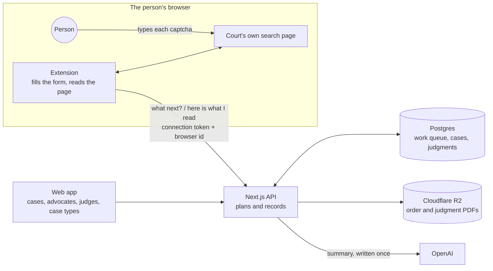

# Court Capture

[](https://github.com/itsdhruvsingh/court-capture/actions/workflows/ci.yml)

Reads Indian court records into a searchable database. It covers two courts:

- **Saket District Court**, through the eCourts portal.
- **The High Court of Delhi.**

A browser extension drives each court's own public search page, and a person types every captcha. The web app stores everything the courts show. Its pages cover:

- the advocates on each case;
- the timeline of hearings and orders;
- judgments by judge and case type;
- case-type breakdowns: Saket's caseload by type and court, from the court's own counts, and each High Court judge's mix of case types;
- one-click AI summaries, saved so each one is written only once.

## What it captures

| Court | A run collects | Kept for each record |
|---|---|---|
| **District court · Saket** | The 10 newest cases of each of the court's 79 case types. Pending cases by default. If a year has too few, it goes back a year at a time, up to 10 years. | The whole case page: parties and advocates, every hearing, every table, and each order with its PDF. |
| **High Court of Delhi** | Up to 20 judgments or orders for every sitting judge, picked at random from everything the judge uploaded in the last 10 years. One search per judge, so one captcha per judge. | The case type, filed under the court's own code (152 types), the neutral citation, parties, the PDF and the court's plain-text copy. The judge's whole list is kept as well, and each entry's PDF link works without a captcha. |

Each court's search is kept as the court answered it, both the listing and the HTML, so more can be read out of it later.

## How it works



- **The server decides; the extension does the clicking.** The extension asks `next`, performs that one step on the court's page and reports what it read. Reports are idempotent, so a reload or a double click never stores anything twice.
- **Shared work.** Every browser claims a case type or a judge for 5 minutes, and a heartbeat renews the claim while its person types. When someone pauses, their share goes back to the pool. A lapsed claim is taken over. Several people can run at once, each on different work, and each person's count is shown.
- **Polite to the courts.** Documents are fetched one at a time:
  - District court order PDFs are downloaded by the extension in the person's browser after it reads their case: in the background, one every 10 seconds, from the same links the case page opens. One the court turns away is tried again half an hour later. The district court shows a bot check to servers that fetch them.
  - High Court PDFs and texts are fetched by the app, 4 seconds apart.
  - If a court shows its "Security Verification" page, fetching from that court stops (the app pauses for 30 minutes) instead of retrying.
- **Captchas are typed by a person.** The extension never reads, solves or fills a captcha. The High Court prints its code as text in the page; the extension still leaves it to the person.

## Engineering highlights

- **Automation with a person in the loop.** The server plans every step and the extension carries it out on the court's own page, so the person's only job is the captcha. Reports are idempotent, so reloads, retries and double clicks are harmless.
- **A shared work queue.** Several people's browsers split one run with no coordination: claims use `FOR UPDATE SKIP LOCKED` with five-minute leases renewed by heartbeat, and per-person counters update atomically in PL/pgSQL.
- **Fewer captchas, from reading the court's own rules.**
  - The High Court page says a search may cover one month, but its own check allows 25,000 days. One search per judge therefore lists everything they uploaded.
  - Its results table pages in the browser, so the extension reads every row and sends the list gzipped. A run needs one captcha per judge instead of dozens.
- **Counting what the courts actually mean.**
  - The district court reuses type codes across its establishments: code 76 is four different case types. Counts and filters therefore follow the printed type.
  - High Court totals count each case once, both when one judgment decides connected cases and when a bench lists a judgment under each judge. SQL views do this, and tests cover it.
- **Polite by design.** Requests go one at a time, and a court's bot check stops fetching instead of being retried. District order PDFs come through the person's browser, because the court blocks servers.
- **Cost control.** An AI summary is claimed in the database so two clicks pay once. It is kept forever, and a monthly budget caps spending.
- **Tested against reality.**
  - Parsers run against real captured court pages.
  - CI runs every migration on Postgres 14.
  - Every table has row-level security on.

## Using the extension

This section is for whoever does the capturing.

1. Sign in to the app and open **Capture**. Click **Download extension**, then unzip it.
2. Open `chrome://extensions` (or `edge://extensions`) and turn on **Developer mode**. Click **Load unpacked** and choose the unzipped `court-capture` folder.
3. Back on **Capture**, click **Connect this browser**. If that button doesn't show, click **Connection code** and paste the code into the extension's popup.
4. Click the extension's icon and pick a court: **District court · Saket** or **High Court of Delhi**. If no run is open, this starts one with the defaults.
5. The court's page opens with a panel in the bottom-right corner. When the captcha box is outlined in red, type the captcha and press **Enter**. That's the whole job.

Notes:
- **Pause** stops the run and hands your share back. **Skip this one** moves past a stuck case page.
- Keep one tab per court. If you open a second tab, the newer one takes over.
- When the High Court says "validation failed", its search session has expired. The extension reloads the page by itself; type the new code.
- Teammates each install the extension and connect it with their own account.

## Setting up the app

You need Node 20 or later, a Supabase project, a Cloudflare R2 bucket and an OpenAI API key.

```bash
npm install
cp .env.example .env.local     # then fill it in
npm run dev                    # http://localhost:3100
```

Then:

1. **Database.** In Supabase, open the SQL Editor and run `supabase/migrations/0050` to `0054` in order. Each one is safe to re-run.
2. **Accounts.** Add people under Supabase → Authentication → Users. Anyone with an account can use the app, so keep public sign-ups turned off.

## Deploying to Vercel

1. Push the repository to GitHub and import it in Vercel. The Next.js defaults work as they are. `vercel.json` runs the server in Mumbai (`bom1`), close to the courts and to the people using it.
2. Add the variables from `.env.example` to the Production and Preview environments.
3. Deploy. Then download the extension from the deployed app's **Capture** page. The zip is built for the address that served it, so one-click connect works on that domain.

## Pages

| Path | Shows |
|---|---|
| `/district` | Cases. Search, and filter by case type, status or advocate. |
| `/district/[id]` | One case: parties and advocates, the hearing timeline, and orders with PDF and AI summary. |
| `/district/advocates` | Advocates, by number of cases. Each one opens their cases. |
| `/district/case-types` | The court's own count of cases by printed case type and by court, for each year and status searched, next to what is captured. |
| `/high-court` | Judgments. Search by case number, party, citation or text, and filter by judge, case type or year. |
| `/high-court/[id]` | One judgment: AI summary, PDF and full text. |
| `/high-court/judges` | Sitting judges, with what has been captured for each. |
| `/high-court/case-types` | Judgments by case type across every judge's full list, and a heatmap of each judge's mix of case types. |
| `/capture` | Runs for both courts, progress per person, new runs, and connecting the extension. |

## API

The extension's calls carry a 30-day connection token (`Authorization: Bearer …`) and an id for each browser (`x-capture-id`):

- `/api/capture/status` and `/api/capture/start`
- `/api/capture/district/{next, search, details, heartbeat, release}`
- `/api/capture/high-court/{next, results, heartbeat, release, judges}`

The app's own calls need a signed-in session:

- `/api/district/*` and `/api/high-court/*`
- `/api/capture/token`, which mints a connection code
- `/api/capture/extension`, which downloads the zip

## Data

**District court:**
- `court_cases`, plus `court_case_advocates`, `court_case_hearings`, `court_case_orders` and `court_case_raw`.
- The run tables: `court_scrape_runs`, `court_scrape_tasks` and `court_scrape_queue`.
- `court_search_results`, which keeps every search.

**High Court:**
- `hc_judgments`, plus `hc_judgment_judges`, which links a judgment to each judge on its bench.
- The reference lists: `hc_judges` and `hc_case_types`.
- The run tables: `hc_runs` and `hc_tasks`.
- `hc_search_results`, which keeps every search.

**AI summaries:** `ai_usage` holds every summary's tokens and cost. Summaries stop for the month when spending reaches `AI_MONTHLY_BUDGET_USD`.

**Case-type breakdowns:** read-only views compute them from the searches already stored (migration 0054):
- `court_type_totals_v`
- `hc_judge_lists_v`
- `hc_judge_type_counts_v`
- `hc_judge_year_counts_v`
- `hc_type_counts_v`

Every table has row-level security on and no policies, so only the server, using the secret key, can read or write them. PDFs are stored in R2 under `court-orders/`.

## Tests

```bash
npm test            # both courts' parsers against real captured pages, bot-check detection, token signing
npm run test:sql    # all migrations on a throwaway Postgres 14; claims, ingest, counters, summaries, breakdowns
npm run typecheck
```

GitHub Actions runs all three on every push, then builds the app (`.github/workflows/ci.yml`).

## Layout

```
app/(app)/            pages: district, high-court, capture
app/api/capture/      what the extension calls
app/api/district/     what the app's pages call
app/api/high-court/   what the app's pages call
lib/district/         eCourts parser and engine (planner and recorder), orders
lib/highcourt/        High Court parser and engine, documents, search dates
lib/                  sign-in, R2 storage, polite fetching, AI summaries and budget, tokens
components/           shared UI; viz.tsx draws the bar lists and the heatmap
extension/            core.js (shared), district.js, highcourt.js, popup, background worker, connect helper
supabase/migrations/  run these in order
scripts/              tests and the court pages they read
```

## Responsible use

- **A person types every captcha.** The extension never reads, solves or gets around a captcha, and it never disguises its requests.
- **Each court's own public search page is used, at a person's pace.** Documents are fetched one at a time. When a court shows its bot check, fetching stops instead of retrying.
- **Court records contain personal data.** Keep any deployment private, use the data lawfully (in India, the Digital Personal Data Protection Act, 2023), and follow each court's terms of use.
- **Not affiliated with any court.** This project is not connected to eCourts, the e-Committee of the Supreme Court, or the High Court of Delhi.

## Limits

- Courts change their pages. The fixtures in `scripts/data/` are real responses. When a court changes its markup, capture a fresh page and the tests will show which field broke.
- The district court masks party names in family cases (`XXXXXXX`). They are stored as the court shows them.
- Court records contain personal data. Keep the deployment private: pages are marked `noindex` and need a sign-in.
